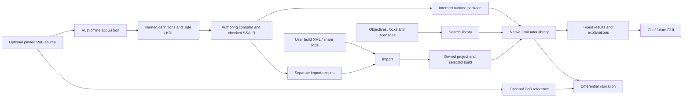

# Project-owned game semantics and native evaluation

Status: accepted architecture, updated 2026-10-23 following the
[owner-provided review](architecture-review-2026-10-22.md). This document defines
**the target**, not a claim that the migration is complete. The
[implementation plan](implementation.md) is the only delivery schedule; the
[execution overview](data-and-evaluation-overview.md) states what runs today.
Product scope belongs in [design](design.md). Earlier detailed contracts preserve
game semantics, but do not mandate old wire formats or publication machinery.

## Decision

Own the build model, definition/rule schemas, evaluation and optimization APIs.
Convert upstream data offline into readable domain declarations and a checked
native package. Author mechanics in a small Rust-implemented formula DSL and
KDL manifests, lower into **one checked SSA IR**, and pack for native execution.
Keep the existing typed checker, explicit-stack VM and occurrence/effect graph
where they satisfy these contracts. This is not a second runtime interpreter.

PoB is optional offline acquisition and a separately hosted reference evaluator.
Its XML/share-code interchange remains supported at Import. Its UI construction,
Lua object model and incidental language behavior are not native domain models.
No SQL/ORM, runtime Lua, per-skill Rust dispatch or fixture-specific build path is
part of the target. Data is injected; changing balanced values or content does not
require editing native evaluator code.

The first complete build must run on this architecture. Break and regenerate
unshipped formats; delete superseded code, formats and commands at cutover. Do
not retain compatibility readers or a parallel native evaluator for hypothetical
future users. The actual PoB oracle and independent regression fixtures remain.

## Components and dependency direction

| Component | Responsibility and allowed dependency |
| --- | --- |
| Core | Owned project/build/scenario/definition identities, typed IR and public reports; no filesystem, UI, PoB or acquisition dependency |
| Data | Validate/load the current runtime package, immutable indexed definitions and metadata; depends on Core |
| Engine | Check/compile IR, compose occurrences, prepare and evaluate; depends on Core/Data, no Import/Authoring/PoB |
| Import | Bounded external build decoding and normalization through injected conversion recipes into the owned model; no legacy source interpreter |
| Authoring | Rust DSL/KDL compiler, catalogs, identity allocation, release construction and checking; can use the native checker; never a runtime dependency |
| Search | Configurable problem, candidates/operators, budgets, archives and scheduling over an evaluator interface; no PoB-specific metric or UI type |
| PoB reference/acquisition | Optional mlua/LuaJIT host and offline extractors; validates its source pin, returns explicit reference observations through adapters |
| Host | Shared filesystem destination handling and atomic no-clobber publication for both CLI hosts; no game, Import or Authoring dependency |
| CLI / later GUI | Compose public libraries, present progress/diagnostics/results; no game formulas or hidden model repair |

The reference host shares only the decoding boundary it needs, not the entire
authoring toolchain. If that boundary needs a small library extraction, keep its
purpose explicit. Native Engine must not depend on a relocated compat interpreter.
Dependency closure, linked features and shipped contents are CI assertions.

The current naming-allocation library temporarily depends from Authoring to
Import so it can reuse the single existing `OwnedIdRegistry` allocator. This
also pulls Import's legacy features into the offline authoring tool; it is not
the final dependency boundary. Import must not depend on Authoring.
Immutable registry and role loading are now separate from offline allocation and
catalog generation. Runtime release loading checks artifacts directly; it does
not invoke the authoring assembler. The production release builder still reuses
that assembler through Import. R1 must move the maintained allocator and publication
core into Authoring, retire obsolete transformation/compiler commands after
preserving their useful behavioral tests, and retain acquisition DTOs in neutral
contracts. These module boundaries alone do not complete the dependency extraction.

Registry readers receive `OwnedIdRegistrySnapshot`: checked canonical history,
identity and lookup without allocation or retirement methods. Offline
`OwnedIdRegistry` wraps that same snapshot and adds mutation bookkeeping;
resuming allocation is explicit. There is one history validator, no mutable
access through the snapshot and no second registry format.

`CheckedOwnedRecipe` separates validation from publication. It owns the immutable
registry and shared schema, stored rules, routing and compiled rules. Executable
rules retain their stored-source identity. Publication staging wraps these checked
components with manifests and encoded artifacts; evaluation validation needs only
the checked components. Consumers share the retained executable and use private
execution scratch.

`CheckedOwnedRelease` applies the same complete constituent validation to offline
inputs and loaded artifacts. Its runtime reader retains checked packages, not
publication buffers. It verifies the exact inventory, hashes, canonical ordering,
cross-package bindings, source union, coverage declarations and aggregate limits.
Canonical serialization is compared directly with supplied byte slices; it does
not allocate another publication. Borrowed typed views preserve input commitments
without reconstructing a complete authoring input. Explicit revision/publication
commands may reconstruct such an input or stage artifacts; metric and source-action
consumers do neither. There is no fallback reader or alternate validator.

Runtime skill-role contracts and validators live in `owned_skill_roles`.
`owned_skill_catalog` imports those contracts for offline generation; runtime role
loading has no dependency on catalog generation. Receipt data retains its original
source-pin subset semantics when a catalog predates later registry additions.
Ordered query DTOs belong to normalization, and immutable evaluation packages are
named for checked storage. CLI filesystem loading and bounded I/O are separate
from publication commands. The host and in-memory reader share one closed
artifact-inventory validator before the host opens declared paths.

## Project, build and scenario models

| Model | Meaning |
| --- | --- |
| BuildProject | User-owned presets/alternatives, inventory, original imports, scenarios, names and optimization requests; presentation metadata is optional |
| BuildSpec | Selected progression, class/ascendancy, allocations, equipment configurations, exact skill occurrences, supports and mechanic choices |
| ScenarioSpec | External enemy/environment/uptime assumptions and typed usage intent/overrides; never frozen candidate-derived effects |
| MetricQuery | Exact actor/action/part/stat-set and measurement/aggregation semantics with units; no implicit sum of every skill |
| OptimizationProblem | Seed build, candidate pools, allowed dimensions, exact locks/requirements, objectives/constraints, scenarios and budgets |
| Prepared plan | Private validated structural interpretation, with indexed parameter slots and per-worker execution scratch |

Stable domain definition IDs and occurrence IDs cross the public boundary.
Package-local dense indices do not. Identical definition names do not merge two
items, skill copies, grants, actors or actions. Reject stale/foreign plan handles.
Cosmetic titles cannot select mechanics.

One generic Actor model covers the player, supplied units and scenario enemy,
with explicit roles, relations and permissions. Encounter rules remain owned by
the encounter; shared actor baselines bind to actual actors and run once. Do not
reintroduce an Enemy execution kind or Player fallback. Slot reads distinguish
empty, unresolved and occupied slots and read the exact equipment use.

Rolled item descriptors, reusable socket configurations and physical inventory
copies remain separate. Equipped uses select configurations and bind child
providers/local effects to an exact host. Stock, modification cost, numerical
behavior and legality are different checks. Passive topology uses injected roots,
ordinary/ascendancy/other point pools, capacities and exceptional access; visual
disconnection does not imply an invalid ascendancy tree.

Typed raw skill slots have explicit authored/provider authority. Skill-preset
bindings target exact generated occurrences; providers can project levels while
presets preserve permitted quality inputs. Source-property preparation reuses
those occurrences, with exact source membership and collection permissions, not
another raw-input model. One authorized writer per slot is required.

Usage preferences belong to skill presets; generated preferences use exact-source
applicability. Proven nonselection may make a preference dormant; missing or
ambiguous authority stays unresolved. Scenario intent resolves against the
composed build, followed by exact Scenario overrides. Validate dormant and
superseded records too. Preferences do not create a skill or enable a disabled
source. Preparation availability and execution participation are separate.

Progression uses existing Choice rewards with typed values. Duplicate authority
is an assessed violation; absence is not zero. Import assigns settings to their
actual build, usage, scenario or presentation owner. Explicit per-consumer
projections can preserve different meaningful uses of one saved setting without
transporting Lua truthiness into native execution.

## Preparation and execution readiness

Use one occurrence/effect graph with explicit requirements for preparation and
stricter execution readiness. Supports may affect final level/quality, so support
preparation cannot require those final values first. Discover all eligible
support sources from the composed build; presets hold authored assignments/order.
An equipment/tree change triggers fresh applicability and completeness checks.
The source census includes every actually declared potential ActionOutput on the
selected loadout, including outputs with no requested metric and descendants of
disabled skills. Disabled participation does not prove absence of a source;
unselected weapon loadouts do not contribute to the selected build. An incomplete
output inventory remains a coverage gap, while a complete empty inventory creates
no synthetic output. Source-domain completeness is separate from numerical rule
completeness: proving that an owner introduces no additional supports cannot
close its unimplemented calculations.

A no-additional-origin declaration is specific to its exact definition or
declared slot across the admitted input domain. Inherited support candidates
remain present; inheritance and compatibility filtering create no new source
authority. Evidence must cover the complete intrinsic constructors, with positive
extra/linked-source controls. Foreign modifiers and dynamically supplied
descendants keep their own coverage obligations. Source text is offline evidence,
not a second parser or evaluator in the native path.

Effects have exact source, recipient, activation and stacking declarations.
Collect source properties once at the permitted source and apply them to eligible
recipients. Post-stacking application groups are explicit producers in the same
contribution graph. Checked queries cover exact Actors, rewards, Skills, Actions,
Encounters and application groups only where permission is declared. Preserve
duplicate occurrences and numerical ordering where meaningful; Boolean Any uses
its typed membership contract. Unknown coverage is never false or an empty sum.

Optional numeric selection distinguishes absent, present (including zero), and
unavailable. Multiple agreeing writers may agree; conflicting/unknown writers do
not gain a winner from source insertion order. Resource obligations belong to
Skills with explicit payer/resource identity and Action dependencies only when
the mechanic requires them. Reservation cannot depend on the requested metrics.

Keep requested reporting multiplicity, actor population, participation, resource
obligations and selected-action damage distinct. These contracts apply equally to
all content; no Offering, Djinn, Spark, Mace or item-name branch belongs in generic
assembly/evaluation. See [build composition](owned-build-contract.md),
[effect applications](owned-effect-applications-proposal.md),
[usage](owned-skill-usage-proposal.md) and
[resource obligations](owned-resource-obligations-proposal.md) for domain detail.

## Semantic data package and rules

There are four representations of one semantic program, not four evaluators:

| Layer | Contract |
| --- | --- |
| Named source | `.rule` formulas and KDL declarations; symbolic kind-checked references, stable bindings, human labels and source spans |
| Checked IR | Existing typed SSA RuleProgram, reads/effects/ownership and operation semantics; the authoritative compilation boundary |
| Canonical artifact | Deterministic compact JSON with namespace hoisted once, kind-checked short IDs and one program per file; review/reproduction output, not hand-authored mechanics |
| Runtime package | Bounded validated binary representation with interned IDs and compact indexed values; native/Wasm execution input |

`names.kdl` provides human-readable symbols mapped to stable typed identities.
Names are authoring references; labels/docs are presentation. The resolved binding
is semantic and participates in compiled content identity. Allocate new bindings
transactionally during publication, validate collisions/stale edits and never
require authors to predict registry positions or renumber references manually.

### Formula DSL

The DSL supports typed inputs/reads, named intermediate values, arithmetic,
conditional branches, existing bounded collection/lookup operations, derivations,
contributions and capabilities. Cover all live IR operations with explicit
constructs; no raw-JSON escape hatch or second evaluator. General runtime scripts,
unbounded loops, filesystem access and arbitrary Rust/Lua callbacks are excluded.
Reusable source blocks expand into checked IR with explicit bindings.

Lowering is exact: preserve expression association and evaluation dependencies.
`a + b + c` is left-associated; no floating-point reassociation. `if` lowers to
lazy Select so an unchosen failure remains unobserved. Percent conversion is an
explicit typed operation; clamp has a documented min/max order. Ambiguous units
are errors. Operators such as Boolean All/Any retain their current typed failure
behavior until a separately reviewed semantic change. Frontend inference and
name resolution feed the existing checker; they do not replace it.

Value names resolve only to declared reads or named intermediate nodes. They
never synthesize a scope, default or provider permission. Unit symbols resolve
to exact schema identities; equal dimensions do not authorize conversion.
Literal suffixes are shorthand, with `quantity(literal, unit.symbol)` for units
that cannot be spelled as a suffix. Bare integer literals use exact bounded
integer parsing; fractional quantities require an explicit unit. Rounding uses
a positive static quantum and explicit mode. Ratio and percent conversion name
their result unit. No operator commutes operands to make a formula type-check.
These are authoring rules; numerical construction and execution retain the
existing Core/Engine behavior, including Core's normalization of signed zero.

`check_domain(value, minimum, maximum)` carries static inclusive bounds with the
value's exact numeric type/unit; it preserves an unsupported result outside the
domain rather than clamping. `lookup(integer_key, "table-id")` refers to an
explicit package table without interpolation, endpoint fallback or inferred rows.
`option(symbol)` names an exact choice identity, not absence or a Boolean flag.
Ordinary timing lowers to the existing atomic recipe: its eight ordered dynamic
inputs remain dependencies for every output channel, with explicit static
precision, reciprocal time/rate units and channel. A frontend table signature
supplies type information only; the complete package checker validates rows,
domain and membership before any evaluation.

Ordered `let` declarations preserve SSA sharing: a later use references the
earlier node rather than repeating its expression or declaring another read.
Aliases emit no node. Retain separately authored equal expressions and unused
nodes during exact migration; perform no implicit deduplication or dead-code
elimination. Declarations do not eagerly execute calculations. Demand still
comes from checked effect values and guards, with the existing lazy VM behavior.
Reject shadowing, duplicate declarations and forward references. One syntax and
emission budget covers the whole program, not a fresh allowance per declaration.

Program-local IDs, execution context, exact reads, expressions and guarded
effects belong in `.rule`. Owner-to-program membership and coverage belong in
KDL with definitions, queries and routing. An Actor execution context is not
an assertion of Actor ownership. The compiler resolves typed symbols directly
into existing Core read/effect variants and submits the complete package to the
existing checker; no second domain model or implicit Complete inventory is added.

Program, read and effect IDs are explicit quoted owned keys. Reads have separate
authoring aliases; renaming an alias does not rename the read's semantic ID.
Declarations are ordered reads, then formulas, then effects. Effects and guards
reference earlier named values, preserving shared graph nodes and inactive
effects without inserting incidental calculations. Definition symbols and exact
slot symbols use separate checked name spaces; a slot binding includes its
declaring definition. The registry proves known addresses, not contextual
permission. KDL publication retains responsibility for allocating stable bindings
and validating the complete release. Quoted keys are metadata, never native
string expressions or a general source-language escape hatch.

Diagnostic spans relate type/unit/ownership failures to named source expressions.
`rule fmt`, `check`, `lower --emit-ir`, `raise` and `explain` are offline developer
tools. Raising existing IR must preserve graph semantics; lowering the result must
be alpha-equivalent, including reads, guards, effects and operator order, with
independent executable vectors. Syntax examples in the review are illustrative,
not authority to change a formula or introduce Player-specific special handling.

Raising uses a deterministic topological order, since existing IR permits
forward references and treats read/node declaration order as nonsemantic. Preserve
effect ledger order and every ordered operand list. Compare graphs through an
explicit node-ID mapping; raw vector equality or the old content digest is not
alpha-equivalence. Retain one declaration per original node, including unused
nodes and repeated reads, and enforce output byte bounds while writing source.
Validate duplicate IDs, dangling references and cycles even in unused graph
regions. Bound input lists, reference occurrences, symbols and output separately;
raise without recursive graph traversal. Missing definition/slot symbols are
errors, not a reason to invent identifiers. Numeric spelling must round-trip
finite quantities and bounded integers exactly. Raising is an offline migration
tool, not a semantic validator or source formatter: formatting must preserve
authored names and comments and be idempotent, independently of IR node naming.
The migration gate covers every exact owner/program occurrence. A program ID is
owner-local and cannot identify a reusable body by itself. Verify both graph
equivalence and exact placement after packet assembly; restore only program bodies
to prove every other package field, including partial coverage, is unchanged.
Use bounded symbol groups that include exact slot-declaration owners, then compile
the complete reconstructed package through the existing Engine. Synthetic aliases
are suitable for compiler tests, not substitutes for reviewed production names.
Also check the actual tracked names, packets and `.rule` sources against the
archived graphs. Exact owner/program placement and all non-program metadata must
match independently of the production composer's assembly decisions. Historical
IR remains test evidence; it is never an alternate production input.
Formatting preserves token spellings and grouping; it only changes structural
whitespace. Preserve comment bodies under the lexer's LF termination rule,
including literal CR or trailing spaces. Output must fit both the output budget
and the parser source budget so it remains admissible with the same settings.

### Declarative manifests and publication

Name manifests declare their game/version namespace once. Current `load_names`
resolves raw known-address aliases directly to existing typed definitions or
exact declared slots; a slot names its declaring definition explicitly.
Definition and slot aliases have separate name spaces. This lookup does not
allocate identities or prove that a persisted binding is current.

The separate `NamedIdRegistry` library stages immutable transactions over the
existing Import allocator. `NamesInput` carries that allocator registry's exact
digest and sorted typed name bindings. Its own identity covers both, so a stale
predecessor check detects alias-only changes as well as allocations and
retirements. An allocation request returns a successor without mutating the
base, including when a late limit check fails.

Allocation order is canonical: definition names first, then slot names, each in
name order. Request permutations therefore produce the same result. Replaying an
active name is idempotent only for its exact kind and, for a slot, exact declaring
owner. An alias must target an active identity already present in the immutable
base; it cannot predict an identity allocated by the same transaction. Retired
bindings remain reserved tombstones in history and count toward limits, but are
excluded from the projected `SymbolRegistry`. Projection still checks active
targets against the actual schema; allocation grants neither schema membership
nor read/effect authority. The Engine remains the complete package checker.

This staged API does not yet provide filesystem compare-and-swap or a KDL
allocation command. The new release-directory builder is a separate operation;
it does not commit a named-allocation transaction. Named publication must still
authenticate the stored predecessor and commit registry and names together. The
existing raw-alias `load_names` path currently remains separate. Checked
per-packet declaration overlays can be integrated into the in-memory compiler
before resolving filesystem publication.

The owner approved atomic authoring checkpoints on October 23, as described in the
[authoring checkpoint proposal](owned-authoring-checkpoint-proposal.md). The runtime
directory has a closed artifact inventory; authoring state cannot be added as an
unlisted file. Stable allocation must persist the registry-bound name ledger, not
recreate it from an empty history on every build. Source compilation must validate
bootstrap commitments before constructing final dependency bindings; runtime
validation must never repair corrupt input. Reuse shared semantic checks and
one maintained compiler path while retiring the historical revision machinery.

The maintained source builder now checks the original dependency space before
lowering any DSL: registry/schema membership, the rule header and routing seals,
Import constituent bindings, nested normalization policies and consistent source
pins. It shares those validators with the runtime reader. Whole-input and recipe
budgets precede constituent cloning. The result retains the checked registry,
schema, routing and Import packages, plus the bounded rule payload whose original
header was checked. Consuming it extracts content from those actual owners;
it grants no permission to discard seals from another input and is not a checked release.
Program-free source metadata cannot satisfy executable queries until lowering
supplies their programs. Complete rule and evaluation-artifact validation therefore
remains mandatory at final assembly. Constructing new dependencies after declaration
allocation remains a separate compiler responsibility, not runtime repair.

Mapping, skill-role, reward, item-line and item-source packages now expose explicit
authored content without runtime dependency seals. Their `bind_new` constructors
derive those seals from the actual checked dependencies and delegate to the same
semantic validators used by runtime loading. Source pins and historical compiler
receipts remain content/provenance; rebinding does not rewrite them. Consuming
`into_authored_content` extraction moves declarations out of checked storage
without another clone. Current item construction rejects implicit upgrades from
older numerical or attribution contracts. Raw sealed runtime artifacts are not
accepted as authored content and remain subject to strict binding validation.

The shared constituent pipeline retains normalization as one private checked owner:
the exact immutable policy plus its existing digest. It constructs that owner only
after all dependent checks, including passive-socket placement, succeed. Runtime
hashing, receipts and public policy access use this same storage. This adds no
standalone validator, public authority or wire format. Content extraction consumes
this storage rather than stripping seals from arbitrary input.

One authored normalization aggregate now reconstructs nested dependencies in their
existing modules. It preserves source evidence, variants, absence and explicit-null
restrictions, and bounds authored bytes before conversion allocates row vectors.
Absent optional content stays omitted, so removing dependency bindings does not
inflate a sparse policy beyond its existing byte budget.
Shared scalar, usage and configuration commitment helpers operate on real constructed
prerequisites. Passive sockets bind Tree content before the final Tree package binds
the complete normalization policy; there is no dependency cycle.

The maintained compiler uses this construction on every build. Its resulting
`ImportSourceInput` is raw data: existing full release validation remains mandatory
before publication or evaluation. Runtime readers still reject stale bindings.
Neither content construction nor source-prefix validation certifies complete
release execution or coverage. Filesystem declaration publication uses the atomic
checkpoint boundary below; source extraction never includes evaluation inputs or overwrites their
unvalidated commitments.
Aggregate evaluation preflight accounts for readiness, receiving preparation,
source properties and their nested lists before digesting or cloning. Partial gap
lists are bounded even when later semantic validation rejects them; generated and
summoner source paths retain independent depth checks under the shared work budget.

Authored evaluation construction follows the existing checked package graph:
recipe to Metrics, Stages and Preparation; Stages/Preparation to Inputs; those
packages to Receiving; all prerequisites to optional Outputs. Extract inherited
content only from fully checked evaluation owners, or author fresh semantic
declarations explicitly. Reuse the shared bounded traversal before hashing or
copying and retain final release assembly. New dependency bindings grant no
coverage: partial source inventories remain blocking, and absent support/outputs
retain their existing meaning.

The six evaluation source components now carry authored content under their
existing manifest labels. Runtime seal fields are rejected by that format;
there is no sealed-input fallback. Metrics, stage classification, preparation,
receiving, readiness and source-property rows reuse the existing semantic types.
Consuming a fully checked release can surrender its actual evaluation owner for
content extraction. Construction derives every current binding from checked
prerequisites and runs the existing constituent validators. Semantic stage and
receiving contracts are preserved explicitly, with no implicit upgrade.

One borrowed semantic view drives the aggregate work traversal for both authored
and runtime inputs. The source builder reserves evaluation work from the same
release counter before checking or copying the other source dependencies.
Final full release assembly still checks the combined graph and budgets; neither
new bindings nor declarations turn partial inventories into complete coverage.
This is offline construction. Runtime artifact loading and candidate evaluation
retain their existing strict input contracts and do not invoke Authoring.

Typed Stat declarations use that same staged allocation and existing Data schema.
The offline KDL `definitions` document names a game/version namespace and each
Stat's value type and allowed entity targets. Quantity units resolve through the
injected symbol registry. Staging returns new names, schema and symbols together;
it never modifies the supplied predecessor or overwrites an existing descriptor.
Saved allocation names can be replayed against the unchanged baseline schema,
while an already installed definition remains a conflict. Input aliases that
overlap persisted names must agree on the exact typed address.

The in-memory release compiler accepts an explicit persisted ledger that is a checked
successor of the immutable bootstrap registry, rather than require registry
identity equality or recreate an empty ledger. Reserved names may lack bootstrap
descriptors until staging. Keep packet aliases local and overlay only the current
declarations, with exact-address agreement for collisions and bounded unique symbol
growth; do not union unrelated packet scopes or project every persisted name.
Construct final rule-shell and routing bindings from their authenticated original
inputs before packet application. Return the successor names and predecessor
identity only after complete release validation and the expected-input check pass.
The current CLI does not accept allocating declarations while its publisher could
discard that ledger. The returned allocation result is immutable and commits no
filesystem state. Rule source content constructs a raw package for lowering;
routing content preserves its existing semantic version and uses the single
validator against the final schema. Final assembly still validates complete rule
semantics and the newly constructed evaluation graph.

These declarations grant no producer, read or write authority and do not close
partial coverage. Programs still pass through the sole lowerer and Engine checker.
Preflight declaration counts, target memberships, registry/symbol growth, schema
entry growth and encoded bytes before cloning the baseline schema. Stored entries
and semantic-link validation work have separate counters under their common
ceiling; adding ordinary Stats must not consume the latter counter. Final schema
construction remains mandatory after preflight. This compiler seam is currently
library-only; release publication must first resolve the workflow above.

Program membership uses explicit definition/slot owners and injected source
labels. A source label is not an instruction to open a file. Program IDs are
owner-local; reuse across distinct owners is allowed, but two aliases to one
owner cannot hide a collision. Lower sources once and bound their expanded
membership cost. Preflight all additions against the exact target schema
identity and namespace before mutation. Preserve existing program order,
partial coverage and gaps, receivers, application groups and query inventories.
The resulting package still needs the Engine's authority checks. Never infer an
owner, mark coverage complete, or silently replace an existing program.

Use the official `kdl-rs` document parser for maintained offline authoring files.
Check source bytes before parsing, then validate retained structure, entries,
depth and decoded text before constructing owned declarations. Reject unknown
metadata and duplicate properties explicitly; the parser's last-property-wins
convenience lookup must not replace those checks. Commented-out content is not
part of the retained model. These validation limits do not bound the upstream
parser's recursion or allocation work: this is not a public-upload ingestion
boundary. Imported user builds and runtime packages use their separate loaders.
No streaming parser, second lexer, parser fork or subprocess is required here.
The first name/membership declarations accept string values only; this is a typed
manifest schema, not a second KDL dialect or an embedded evaluator.

KDL manifests declare definitions, rules, typed input projections, contribution
queries, membership additions, routing, source references, fixtures and
dependencies. Production `check-packet` and `publish-packet` commands own this
workflow. Tests invoke them through shared APIs; tests are not the publisher.
Maintain an authoring index from external fields/reference outputs to their owned
meaning to diagnose duplicate/conflicting models early.

Build a release from a tracked manifest and pinned inputs with a deterministic
order and atomic output. Full reproduce checks happen in authoring/CI. Retain
semantic fixture expectations and artifact integrity; delete Rust-source hashes,
layout counts, duplicated ID restatements and receipt types that merely encode
the current implementation. Source provenance is a sidecar, not behavior identity.

The current R1 production seam is `release.kdl`, which declares the final
constituent composition directly. `poe-author release build <manifest> --bootstrap
--output <new-directory>` decodes those explicitly named inputs into the existing typed
`OwnedReleaseInput` and invokes the single release assembler. It does not replay
test staging functions or predecessor histories, synthesize missing mechanics,
repair stale bindings, or certify complete-build coverage. Schema, tables,
coverage and other metadata still use existing JSON DTOs, plain or explicitly
gzip-encoded. Their declaration migration and the compiled runtime package remain
R1-R4 work. Production program bodies come from tracked `.rule` sources and
semantic KDL names and membership packets.

The manifest schema is closed: registry, schema, rules, routing, mapping, roles,
normalization, rewards, item rules and item-source policy are required. Tree
normalization and provenance are optional. Metrics may stand alone; support
stages, preparation, input bindings and receiving must appear together with
metrics, with optional support outputs. Named query sets retain manifest order.
Unknown fields, duplicate components/query names and incomplete evaluation
groups fail. Optional `expected_input` asserts the exact assembled release-input
identity; it grants no completeness or reference-parity claim.

The authoring result is one immutable checkpoint: `checkpoint.json`, `names.json`
and the closed `runtime/` release directory. Every CLI build uses this layout.
Bootstrap is explicit. Later builds select `--predecessor <checkpoint>` and
`--expected-predecessor <identity>`; they fully validate that runtime release and
its registry-bound name ledger before retaining allocation history. Even a build
without new declarations preserves reserved names and the predecessor registry.
The receipt binds the predecessor, canonical ledger, runtime receipt and exact
encoded manifest/source inventory. Comments or transport changes can change this
authoring identity without changing runtime behavior. Digests alone confer no
semantic authority. The CLI emits checkpoint receipt JSON on stdout and the checkpoint
identity on stderr. This selects an immutable predecessor; it does not advance a
mutable head or claim compare-and-swap. A future head requires real concurrency
control against its stored predecessor.

Optional `stat-declarations "definitions.kdl" names="declaration-names.kdl"`
uses the same closed source inventory and bounded parsers. Its symbol scope
resolves existing units against the checked source schema. Declaration staging
overlays only currently declared names onto each packet's own symbol scope;
persisted reserved names do not become executable merely by existing in history.
No separate allocation command or runtime-only authoring publication path exists.

The first production declarations expose initial skill-type facts as generic
Boolean Stats on exact Skill occurrences. Own-skill and minion memberships have
separate channels, with explicit minion-context presence. An absent context does
not manufacture false membership values; an unknown presence remains unavailable.
The current 34-type projection is a preparation contract, not the complete game
type vocabulary. Acquisition evidence retains excluded raw types so widening that
contract is deliberate. Definition-owned rules supply these facts through the
same checked IR and occurrence plan as other mechanics. No skill-name dispatch or
special native evaluator is introduced, and adding a fact does not certify the
owner's remaining programs or complete-build coverage.

Canonical allocation history must be available from a clean clone. The bounded
first-generation bridge pins an immutable Git source revision and expected
checkpoint digest in the [canonical reference](../data/owned/poe2/3887ae68/authoring-genesis.md),
outside the compiled inventory. Reproduce that fixed genesis,
verify and load it through the ordinary checkpoint reader, then use it as the
predecessor for current source builds. Never bootstrap evolving current sources
to recover IDs. Before a second allocation generation needs a new predecessor,
R3 must provide an archived/distributed complete checked snapshot; do not grow a
chain of historical source rebuilds. Source-format cutovers regenerate the
canonical checkpoint deliberately instead of retaining compatibility readers.

Rule source composition uses `rule-packet "family/packet.kdl"
names="family/names.kdl"` and explicit `rule-source "rules/example.rule"`
declarations in that same manifest. Packet memberships resolve only to declared
rule sources. Names resolve against the actual validated schema; they do not
grant read, write or owner authority. The existing packet lowerer constructs IR,
then the sole release assembler and Engine checker validate the complete result.
The source rules constituent must always contain no embedded program members.
The normal release builder rejects embedded IR even when no packets are declared;
a program-free composition may still omit packets. Tables, owner order, partial
closure and other rule metadata remain explicit. Source errors have no raw-program
fallback.

Paths have one role. Packets may share one names file, and memberships may reuse
one declared rule file; both are inventoried and decoded once. Every declared
rule source must be used. Repeated memberships are charged separately against
expanded source and IR budgets, even when they share a file or program ID.
Distinct bodies with the same local program ID remain independent. Node renaming
changes compiled identity: dependent authored bindings must match the actual
composed package; composition never repairs stale headers or reference evidence.

The library receives injected source bytes. The CLI resolves bounded regular
files within the manifest directory. Encoded and decoded aggregate byte budgets
are independent, alongside source/component/packet counts, expanded rule work
and typed assembly limits. `plain` is the default transport encoding; rule,
packet and names files are plain UTF-8. Constituent DTOs can opt into gzip. Gzip is a
single-member lossless transport: trailing bytes and concatenated members fail.
Only after complete assembly succeeds does the shared Host crate publish the
whole checkpoint through one no-replace rename. Its bounded bundle API accepts
root files and immediate child directories of files, rejects nonportable names
and case-insensitive collisions before staging, and shares the transaction with
the existing flat publisher. Host has no game dependencies. This provides atomic
visibility, not power-loss durability. Runtime consumers load `runtime/` through
the existing checked reader without publication reassembly or authoring ledgers.

The tracked source cutover under
[`migration-source`](../data/owned/poe2/3887ae68/migration-source/release.kdl)
replaces captured program bodies with semantic names, explicit packets and DSL.
The conversion passes its preservation gates; detailed validation belongs in the
[implementation plan](implementation.md). The immutable pre-migration IR corpus is
retained only in Authoring's
[`tests/fixtures/retained-rules.json.gz`](../crates/poe-optimizer-authoring/tests/fixtures/retained-rules.json.gz).
Its historical receipt
authenticates the archived bytes. Tests remove only the exact admitted 69-Stat,
one-program and 349 support-domain additions, restore the archived program
members, and reconstruct the original dependency bindings with maintained content
constructors. The existing
assembler then checks every historical artifact and provenance field. A separate
corpus gate preserves original graph semantics and owner/program placement.

Intrinsic support-source absence is an explicit reviewed declaration, separate
from numerical completeness and inherited or externally supplied sources. Proof
families may authenticate full source constructors or inspect complete checked
owned programs and declarations. Neither an empty selected list nor an incomplete
program inventory proves absence. Move reusable proof laws into the maintained
release harness and remove their replaced publication paths at each cutover.
Historical proof packets retain their own coverage state; current owners may
have independently advanced without changing that historical evidence.
For a selectable passive, the proof includes every admitted option and its
constructor dispatch, exact occurrence-owned choice slot, and current program
effects. Saved selections demonstrate build relevance; they do not bound a
definition's possible behavior. A missing required choice remains unresolved.
Numeric passive families also retain every source effect and the corresponding
current channels and conditional receivers. Matching display text on another
node does not certify its identity, constructor behavior or complete program
inventory; source-domain additions remain bounded to independently reviewed
definitions.
Conditional definitions require evidence for every admitted branch, including
whole-list replacements, rather than only the selected character's branch.
Intrinsic source absence does not close a contribution-query membership or the
separate provider inventory of an occupied socket. Flag mechanics retain typed
Boolean contributions and their checked reduction independently of source-domain
classification.
An intrinsic support domain can be known while numerical programs remain
Partial and a definition has positive Skill grants. Preserve those exact grant
and supply relationships; the generated Skill and its Actor/output descendants
are independently checked sources. Structural completeness in one facet cannot
close another. Unparsed modifier text requires independently reviewed semantics,
not an empty-list inference.
Class-local certification includes the complete class record and its attribute
and unarmed initialization boundaries. Referenced start nodes and Ascendancies
retain their own authority, as do equipped weapons and foreign modifiers that
replace unarmed values. A Class declaration cannot certify these related owners.

This representation change adds no evaluation bundle or numerical coverage;
0/5 supplied originals are complete. Schema/table/metadata JSON, historical Rust
publication helpers, the remaining legacy stack and runtime/authoring boundary
cleanup still require R1-R4 work. Retiring embedded program input does not finish
that migration or the first-build gate.

### Runtime representation and storage

Separate runtime, Import, authoring and reference roles. The evaluator loads only
schema/rules/routing/metric data needed for execution. Import may separately load
conversion recipes; acquisition data and UI/reference ledgers do not ship in the
native calculation package. No database/ORM is needed; autocomplete queries the
loaded definition/index model later.

Validate bounded bytes, collection counts, indices, types and operation contracts
once at load. Intern IDs to package-local handles; arithmetic values contain a
number/typed tag and compact unit handle, not heap Strings. Immutable data is
shared; scratch is worker-private. Binary codec selection is an implementation
benchmark between serialization/validation approaches, not a zero-copy promise.

Track canonical review output and a named content manifest. Large runtime bundles
are reproducible build/release artifacts addressed by digest. Never require a
local `runs/` predecessor. Keep runtime and authoring limits separate and explicit;
measure headroom and memory, not just serialized size. Optional lossless table
segments must preserve exact domain values and rounding; fitted curves do not
authorize interpolation or extrapolation.

## Offline acquisition and updates

PoB Lua may execute under **mlua with LuaJIT** in offline acquisition/reference
hosting. That is distinct from the project-owned native SSA evaluator. Offline
extraction resolves source tables/functions into owned declarations; export source
identities and findings in sidecars, not executable Lua values/callbacks in rules.
Other data sources can populate the same model with appropriate provenance.

One manifest pins the reference source and extraction inputs. An explicit Rust
data-build command produces packages; ordinary Cargo builds and candidate
execution do not fetch PoB or regenerate definitions. Pin updates use a runbook:
acquire/verify, extract, compare semantic differences, run component and unchanged
build differential tests, review discrepancies, publish a new current package.
Use stable, uniquely checked semantic source anchors where probes need them.

Import decodes user XML/share codes with bounded inflate and one checked parsing
boundary. Preserve source sidecars for inspection/export; normalize only supported
meanings into typed inputs. Necessary external syntax is local to Import. It is
not a requirement to reimplement PoB's public Lua parser, cache or UI lifecycle.
Account for unknown relevant fields with precise diagnostics; do not silently
repair or default an unsupported original. Repeated normalization against an
immutable prepared policy must preserve results, independent of cache state.

## Evaluation, search and presentation

The public native Evaluator accepts an injected immutable dataset, owned selected
build, scenario and metric request. It prepares a validated structural plan,
binds a candidate parameter vector, executes with caller/worker scratch and
returns typed metrics, coverage diagnostics and requirement assessment from the
same attempt. CLI, search and UI use this API; CLI code contains no formulas.

Separate structural inputs from execution parameters using declared dependencies.
Values affecting grants, supports, eligibility, readiness, topology or coverage
invalidate corresponding structure. Do not classify all numeric changes as safe
parameter edits. Cache keys include dataset/operation semantics, structural inputs
and scenario/query scope. Package/plan handles are identity-bound. Bounded caches
are explicit and optional; results must be independent of cache state. Rebuild
and re-evaluate finalists independently of search caches.

Use direct native Rayon evaluation with shared immutable packages/plans and private
scratch. Bound CPU, memory and in-flight work; integrate search results by proposal
sequence for deterministic count-budget runs. Wall-clock stopping has explicitly
weaker reproducibility and records completed work. No subprocess is needed in the
native candidate loop. PoB process isolation belongs only to optional reference
validation. A warm oracle pool requires demonstrated reset/isolation equivalence
before adoption, not a throughput assumption.

Measure import/load/preparation/compile/execute/report costs separately and end to
end. Interning and plan reuse must improve measured behavior without weakening
coverage. Objectives bind directly to owned metric identities with units, exact
recipients and aggregation, not a PoB output-name map. Missing, non-finite or
unresolved measurements cannot silently satisfy a constraint.

Presentation consumes typed progress/results and explanations with source/rule
provenance. Keep output/rendering separate from calculations. Cancellation, files,
threads and progress are host capabilities; browser/Wasm can run a responsive
single-worker mode if native threading facilities are unavailable.

## Parity boundary

Validate actual game behavior against pinned PoB and independent laws, not against
an old Rust reimplementation of PoB. Compare matching actor/action, scenario,
aggregation, numeric values **and availability**. A complete-build result also
needs complete required coverage and requirement/legality assessment. Partial
component parity is useful evidence, never whole-build success.

Native results must be deterministic for a given semantic input. Fresh reference
replays under a fixed protocol must agree. Do not retry until a favorable result,
encode source cache state, or silently accept drift. The demonstrated Frost
initialization bug has a narrow explicit exclusion for the affected comparison;
other metrics/builds still need stable references. The synthetic rare-Amulet
rename exposing Kalandra's Touch title routing is likewise a narrow upstream
exception, not an obtainable item or a pass for actual unique mechanics.

Migration preserves numeric semantics first. Changes to integer aggregation,
failure precedence, equality, rounding or finite ranges require targeted tests
and explicit decisions where observable behavior changes. Checked unsupported
domains remain explicit rather than importing accidental source-language behavior.

## Distribution and retirement boundary

The supported native distribution includes the owned runtime package and caller
project inputs, not PoB, a Lua emulator, authoring tools or the embedded legacy
snapshot. Validate this from a fresh directory and in dependency/package checks.
Keep only one current format/reader and native evaluator after cutover. Remove
old CLI routes, profiles, source-program machinery, unused artifacts, version
branches and exclusive tests with their last necessary consumer.

A temporary offline converter is migration work with a deletion gate, not a
supported backend. Retain actual PoB optional reference tools and meaningful
behavioral fixtures. No complete five-build gate is required to remove dead code;
the first complete new-format build requires the obsolete production paths gone.
See the [migration map](architecture-migration.md) and
[retirement register](legacy-retirement.md).

## Tooling and test language

Project-maintained compilers, data tooling and new tests use Rust, including
ad-hoc generators. Shell orchestrates tools/CI/Git; it does not implement another
data model. Replace or delete existing Python utilities with their live consumers
during cutover; do not merely rewrite tests around an obsolete Python workflow.
Upstream Lua/reference probes remain optional source-specific tooling.

One data-driven semantic harness replaces per-packet publication programs and
source-text tests. Share ordinary support modules; consolidate integration targets
and run explicit current integration coverage in CI. Test meaningful invariants,
bounded malformed inputs, deterministic execution, units/ownership, real mechanic
vectors and full-build parity. Preserve independent fixtures when deleting their
old scaffolding. No new receipt type is justified solely by a refactor.

Behavioral tests build the maintained declared release once and share its checked
packages, with per-execution scratch. Arithmetic fixtures supply independent
inputs/expected values; data-mutation tests edit declared DSL and must invalidate
the prior commitment. Original-build fixtures consume unchanged external builds
and current normalization policies, preserving unresolved coverage and exact
occurrence provenance. Actor/skill isolation and parallel determinism checks run
as ordinary tests without a manually published predecessor. These component laws
do not substitute for complete-build parity. Keep optional upstream acquisition
authentication beside the offline exporter tests when retiring historical chains.

Support admission must distinguish definition-owned eligibility data from facts
of an exact composed occurrence. Actor identity, supplying source and summoner
relationships cannot be asserted by imported usage preferences. The
[support target facts proposal](owned-support-target-facts-proposal.md) records the
remaining structural-read decision; until approved and implemented, missing
production predicates remain unavailable. PoB object presence is not by itself a
native gameplay definition. Preparation must require a conditional eligibility
fact only when a selected support consumes it; missing unused facts stay unknown,
without blocking otherwise supported work or becoming false defaults.
The computed preparation and delivery drivers preserve bounded unavailable-input
causes until the existing applicability policy determines whether they matter.
Diagnostics use the exact originating support definition, including after ordered
replacement; a retained position is not an origin identity. Hard errors, work
limits, complete type inventories and source/stage authority retain their existing
checks. This adapter does not add a second policy or new public source-read API.
Initial type memberships belong to definition data, expressed through typed Stat
declarations and rule producers in the maintained authoring source. Their symbols
use the same transactional allocator as other definitions before program lowering.
Complete membership in a declared vocabulary may establish negative type facts;
absence of an unrelated source field does not establish a false prohibition.
Provider-specific restrictions stay attached to their exact occurrence.

### Command-line parsing

`clap` is the project standard for all Rust command-line entry points, including
the runtime CLI, offline authoring tools and retained developer examples. Use it
for new commands and options immediately. Prefer its `Parser`, `Args` and
`Subcommand` derives; use its builder/value-parser APIs when a command needs them.
Command structure, option handling, help/usage and argument errors belong to
`clap`. Do not add a parallel argv tokenizer or handwritten help dispatcher.

Keep parsed arguments at the executable boundary. Libraries receive typed inputs
and retain domain validation, bounded reads and publication checks. `clap` belongs
in executable dependencies or example dev-dependencies, outside model/evaluation
APIs. Share its dependency declaration through the Cargo workspace. This standard
does not change the formula DSL, KDL or external build-format parsers.

Converge retained custom CLI parsers on this standard and delete their old parsing
code; retire obsolete tools instead of migrating them. Conventional `clap` help
and diagnostics may replace incidental custom behavior without compatibility
shims. The [implementation plan](implementation.md#cli-parsing-convergence)
tracks the remaining entry points and behavioral checks.

## Options and consequences

The chosen DSL retains a verified execution substrate while making formulas and
ownership readable. It adds a frontend and release compiler but deletes manual
IR authoring and test-based publishing. Compile/pack costs are paid offline;
preparation and native execution remain measurable, reusable and parallel.

Runtime Lua/general scripting would retain source/runtime coupling. Handwritten
per-content Rust handlers would hard-code game data and hinder breadth. A database
would add deployment/query machinery without solving rule ownership or execution.
All are outside this design. Optional native operation families remain appropriate
for genuinely general algorithms, with typed contracts and data-defined inputs.

## Import breadth obligations

All supported originals and later corpus builds use the same ordinary import,
evaluation and optimization path without manual repair. Validate decode, fidelity,
semantic admission, deterministic calculation, numerical parity, legal search and
export/reimport separately. Use development cases plus independent holdouts across
mechanic intersections; no build-specific branch may close a gap. Source categories
are not domain types: conversion can emit zero, one or many owned declarations.
PoE1 is a future separate dataset/profile, not permission to mix versions.
