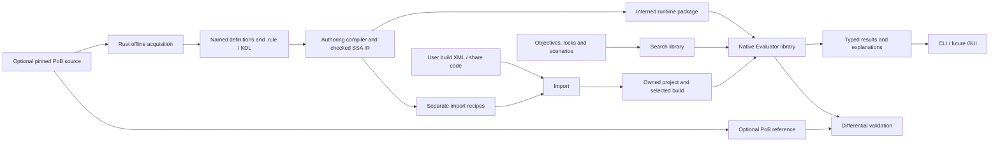

# Project-owned game semantics and native evaluation

Status: accepted architecture, updated 2026-10-22 following the
[owner-provided review](architecture-review-2026-10-22.md). This document defines
**the target**, not a claim that the migration is complete. The
[implementation plan](implementation.md) is the only delivery schedule; the
[execution overview](data-and-evaluation-overview.md) states what runs today.
Product scope belongs in [design](design.md). Earlier detailed contracts preserve
game semantics, but do not mandate old wire formats or publication machinery.

## Decision

Own the build model, definition/rule schemas, evaluation and optimization APIs.
Convert upstream data offline into readable domain declarations and a checked
native package. Author mechanics in a small Rust-implemented formula DSL and
KDL manifests, lower into **one checked SSA IR**, and pack for native execution.
Keep the existing typed checker, explicit-stack VM and occurrence/effect graph
where they satisfy these contracts. This is not a second runtime interpreter.

PoB is optional offline acquisition and a separately hosted reference evaluator.
Its XML/share-code interchange remains supported at Import. Its UI construction,
Lua object model and incidental language behavior are not native domain models.
No SQL/ORM, runtime Lua, per-skill Rust dispatch or fixture-specific build path is
part of the target. Data is injected; changing balanced values or content does not
require editing native evaluator code.

The first complete build must run on this architecture. Break and regenerate
unshipped formats; delete superseded code, formats and commands at cutover. Do
not retain compatibility readers or a parallel native evaluator for hypothetical
future users. The actual PoB oracle and independent regression fixtures remain.

## Components and dependency direction

| Component | Responsibility and allowed dependency |
| --- | --- |
| Core | Owned project/build/scenario/definition identities, typed IR and public reports; no filesystem, UI, PoB or acquisition dependency |
| Data | Validate/load the current runtime package, immutable indexed definitions and metadata; depends on Core |
| Engine | Check/compile IR, compose occurrences, prepare and evaluate; depends on Core/Data, no Import/Authoring/PoB |
| Import | Bounded external build decoding and normalization through injected conversion recipes into the owned model; no legacy source interpreter |
| Authoring | Rust DSL/KDL compiler, catalogs, identity allocation, release construction and checking; can use the native checker; never a runtime dependency |
| Search | Configurable problem, candidates/operators, budgets, archives and scheduling over an evaluator interface; no PoB-specific metric or UI type |
| PoB reference/acquisition | Optional mlua/LuaJIT host and offline extractors; validates its source pin, returns explicit reference observations through adapters |
| CLI / later GUI | Compose public libraries, present progress/diagnostics/results; no game formulas or hidden model repair |

The reference host shares only the decoding boundary it needs, not the entire
authoring toolchain. If that boundary needs a small library extraction, keep its
purpose explicit. Native Engine must not depend on a relocated compat interpreter.
Dependency closure, linked features and shipped contents are CI assertions.

## Project, build and scenario models

| Model | Meaning |
| --- | --- |
| BuildProject | User-owned presets/alternatives, inventory, original imports, scenarios, names and optimization requests; presentation metadata is optional |
| BuildSpec | Selected progression, class/ascendancy, allocations, equipment configurations, exact skill occurrences, supports and mechanic choices |
| ScenarioSpec | External enemy/environment/uptime assumptions and typed usage intent/overrides; never frozen candidate-derived effects |
| MetricQuery | Exact actor/action/part/stat-set and measurement/aggregation semantics with units; no implicit sum of every skill |
| OptimizationProblem | Seed build, candidate pools, allowed dimensions, exact locks/requirements, objectives/constraints, scenarios and budgets |
| Prepared plan | Private validated structural interpretation, with indexed parameter slots and per-worker execution scratch |

Stable domain definition IDs and occurrence IDs cross the public boundary.
Package-local dense indices do not. Identical definition names do not merge two
items, skill copies, grants, actors or actions. Reject stale/foreign plan handles.
Cosmetic titles cannot select mechanics.

One generic Actor model covers the player, supplied units and scenario enemy,
with explicit roles, relations and permissions. Encounter rules remain owned by
the encounter; shared actor baselines bind to actual actors and run once. Do not
reintroduce an Enemy execution kind or Player fallback. Slot reads distinguish
empty, unresolved and occupied slots and read the exact equipment use.

Rolled item descriptors, reusable socket configurations and physical inventory
copies remain separate. Equipped uses select configurations and bind child
providers/local effects to an exact host. Stock, modification cost, numerical
behavior and legality are different checks. Passive topology uses injected roots,
ordinary/ascendancy/other point pools, capacities and exceptional access; visual
disconnection does not imply an invalid ascendancy tree.

Typed raw skill slots have explicit authored/provider authority. Skill-preset
bindings target exact generated occurrences; providers can project levels while
presets preserve permitted quality inputs. Source-property preparation reuses
those occurrences, with exact source membership and collection permissions, not
another raw-input model. One authorized writer per slot is required.

Usage preferences belong to skill presets; generated preferences use exact-source
applicability. Proven nonselection may make a preference dormant; missing or
ambiguous authority stays unresolved. Scenario intent resolves against the
composed build, followed by exact Scenario overrides. Validate dormant and
superseded records too. Preferences do not create a skill or enable a disabled
source. Preparation availability and execution participation are separate.

Progression uses existing Choice rewards with typed values. Duplicate authority
is an assessed violation; absence is not zero. Import assigns settings to their
actual build, usage, scenario or presentation owner. Explicit per-consumer
projections can preserve different meaningful uses of one saved setting without
transporting Lua truthiness into native execution.

## Preparation and execution readiness

Use one occurrence/effect graph with explicit requirements for preparation and
stricter execution readiness. Supports may affect final level/quality, so support
preparation cannot require those final values first. Discover all eligible
support sources from the composed build; presets hold authored assignments/order.
An equipment/tree change triggers fresh applicability and completeness checks.

Effects have exact source, recipient, activation and stacking declarations.
Collect source properties once at the permitted source and apply them to eligible
recipients. Post-stacking application groups are explicit producers in the same
contribution graph. Checked queries cover exact Actors, rewards, Skills, Actions,
Encounters and application groups only where permission is declared. Preserve
duplicate occurrences and numerical ordering where meaningful; Boolean Any uses
its typed membership contract. Unknown coverage is never false or an empty sum.

Optional numeric selection distinguishes absent, present (including zero), and
unavailable. Multiple agreeing writers may agree; conflicting/unknown writers do
not gain a winner from source insertion order. Resource obligations belong to
Skills with explicit payer/resource identity and Action dependencies only when
the mechanic requires them. Reservation cannot depend on the requested metrics.

Keep requested reporting multiplicity, actor population, participation, resource
obligations and selected-action damage distinct. These contracts apply equally to
all content; no Offering, Djinn, Spark, Mace or item-name branch belongs in generic
assembly/evaluation. See [build composition](owned-build-contract.md),
[effect applications](owned-effect-applications-proposal.md),
[usage](owned-skill-usage-proposal.md) and
[resource obligations](owned-resource-obligations-proposal.md) for domain detail.

## Semantic data package and rules

There are four representations of one semantic program, not four evaluators:

| Layer | Contract |
| --- | --- |
| Named source | `.rule` formulas and KDL declarations; symbolic kind-checked references, stable bindings, human labels and source spans |
| Checked IR | Existing typed SSA RuleProgram, reads/effects/ownership and operation semantics; the authoritative compilation boundary |
| Canonical artifact | Deterministic compact JSON with namespace hoisted once, kind-checked short IDs and one program per file; review/reproduction output, not hand-authored mechanics |
| Runtime package | Bounded validated binary representation with interned IDs and compact indexed values; native/Wasm execution input |

`names.kdl` provides human-readable symbols mapped to stable typed identities.
Names are authoring references; labels/docs are presentation. The resolved binding
is semantic and participates in compiled content identity. Allocate new bindings
transactionally during publication, validate collisions/stale edits and never
require authors to predict registry positions or renumber references manually.

### Formula DSL

The DSL supports typed inputs/reads, named intermediate values, arithmetic,
conditional branches, existing bounded collection/lookup operations, derivations,
contributions and capabilities. Cover all live IR operations with explicit
constructs; no raw-JSON escape hatch or second evaluator. General runtime scripts,
unbounded loops, filesystem access and arbitrary Rust/Lua callbacks are excluded.
Reusable source blocks expand into checked IR with explicit bindings.

Lowering is exact: preserve expression association and evaluation dependencies.
`a + b + c` is left-associated; no floating-point reassociation. `if` lowers to
lazy Select so an unchosen failure remains unobserved. Percent conversion is an
explicit typed operation; clamp has a documented min/max order. Ambiguous units
are errors. Operators such as Boolean All/Any retain their current typed failure
behavior until a separately reviewed semantic change. Frontend inference and
name resolution feed the existing checker; they do not replace it.

Diagnostic spans relate type/unit/ownership failures to named source expressions.
`rule fmt`, `check`, `lower --emit-ir`, `raise` and `explain` are offline developer
tools. Raising existing IR must preserve graph semantics; lowering the result must
be alpha-equivalent, including reads, guards, effects and operator order, with
independent executable vectors. Syntax examples in the review are illustrative,
not authority to change a formula or introduce Player-specific special handling.

### Declarative manifests and publication

KDL manifests declare definitions, rules, typed input projections, contribution
queries, membership additions, routing, source references, fixtures and
dependencies. Production `check-packet` and `publish-packet` commands own this
workflow. Tests invoke them through shared APIs; tests are not the publisher.
Maintain an authoring index from external fields/reference outputs to their owned
meaning to diagnose duplicate/conflicting models early.

Build a release from a tracked manifest and pinned inputs with a deterministic
order and atomic output. Full reproduce checks happen in authoring/CI. Retain
semantic fixture expectations and artifact integrity; delete Rust-source hashes,
layout counts, duplicated ID restatements and receipt types that merely encode
the current implementation. Source provenance is a sidecar, not behavior identity.

### Runtime representation and storage

Separate runtime, Import, authoring and reference roles. The evaluator loads only
schema/rules/routing/metric data needed for execution. Import may separately load
conversion recipes; acquisition data and UI/reference ledgers do not ship in the
native calculation package. No database/ORM is needed; autocomplete queries the
loaded definition/index model later.

Validate bounded bytes, collection counts, indices, types and operation contracts
once at load. Intern IDs to package-local handles; arithmetic values contain a
number/typed tag and compact unit handle, not heap Strings. Immutable data is
shared; scratch is worker-private. Binary codec selection is an implementation
benchmark between serialization/validation approaches, not a zero-copy promise.

Track canonical review output and a named content manifest. Large runtime bundles
are reproducible build/release artifacts addressed by digest. Never require a
local `runs/` predecessor. Keep runtime and authoring limits separate and explicit;
measure headroom and memory, not just serialized size. Optional lossless table
segments must preserve exact domain values and rounding; fitted curves do not
authorize interpolation or extrapolation.

## Offline acquisition and updates

PoB Lua may execute under **mlua with LuaJIT** in offline acquisition/reference
hosting. That is distinct from the project-owned native SSA evaluator. Offline
extraction resolves source tables/functions into owned declarations; export source
identities and findings in sidecars, not executable Lua values/callbacks in rules.
Other data sources can populate the same model with appropriate provenance.

One manifest pins the reference source and extraction inputs. An explicit Rust
data-build command produces packages; ordinary Cargo builds and candidate
execution do not fetch PoB or regenerate definitions. Pin updates use a runbook:
acquire/verify, extract, compare semantic differences, run component and unchanged
build differential tests, review discrepancies, publish a new current package.
Use stable, uniquely checked semantic source anchors where probes need them.

Import decodes user XML/share codes with bounded inflate and one checked parsing
boundary. Preserve source sidecars for inspection/export; normalize only supported
meanings into typed inputs. Necessary external syntax is local to Import. It is
not a requirement to reimplement PoB's public Lua parser, cache or UI lifecycle.
Account for unknown relevant fields with precise diagnostics; do not silently
repair or default an unsupported original. Repeated normalization against an
immutable prepared policy must preserve results, independent of cache state.

## Evaluation, search and presentation

The public native Evaluator accepts an injected immutable dataset, owned selected
build, scenario and metric request. It prepares a validated structural plan,
binds a candidate parameter vector, executes with caller/worker scratch and
returns typed metrics, coverage diagnostics and requirement assessment from the
same attempt. CLI, search and UI use this API; CLI code contains no formulas.

Separate structural inputs from execution parameters using declared dependencies.
Values affecting grants, supports, eligibility, readiness, topology or coverage
invalidate corresponding structure. Do not classify all numeric changes as safe
parameter edits. Cache keys include dataset/operation semantics, structural inputs
and scenario/query scope. Package/plan handles are identity-bound. Bounded caches
are explicit and optional; results must be independent of cache state. Rebuild
and re-evaluate finalists independently of search caches.

Use direct native Rayon evaluation with shared immutable packages/plans and private
scratch. Bound CPU, memory and in-flight work; integrate search results by proposal
sequence for deterministic count-budget runs. Wall-clock stopping has explicitly
weaker reproducibility and records completed work. No subprocess is needed in the
native candidate loop. PoB process isolation belongs only to optional reference
validation. A warm oracle pool requires demonstrated reset/isolation equivalence
before adoption, not a throughput assumption.

Measure import/load/preparation/compile/execute/report costs separately and end to
end. Interning and plan reuse must improve measured behavior without weakening
coverage. Objectives bind directly to owned metric identities with units, exact
recipients and aggregation, not a PoB output-name map. Missing, non-finite or
unresolved measurements cannot silently satisfy a constraint.

Presentation consumes typed progress/results and explanations with source/rule
provenance. Keep output/rendering separate from calculations. Cancellation, files,
threads and progress are host capabilities; browser/Wasm can run a responsive
single-worker mode if native threading facilities are unavailable.

## Parity boundary

Validate actual game behavior against pinned PoB and independent laws, not against
an old Rust reimplementation of PoB. Compare matching actor/action, scenario,
aggregation, numeric values **and availability**. A complete-build result also
needs complete required coverage and requirement/legality assessment. Partial
component parity is useful evidence, never whole-build success.

Native results must be deterministic for a given semantic input. Fresh reference
replays under a fixed protocol must agree. Do not retry until a favorable result,
encode source cache state, or silently accept drift. The demonstrated Frost
initialization bug has a narrow explicit exclusion for the affected comparison;
other metrics/builds still need stable references. The synthetic rare-Amulet
rename exposing Kalandra's Touch title routing is likewise a narrow upstream
exception, not an obtainable item or a pass for actual unique mechanics.

Migration preserves numeric semantics first. Changes to integer aggregation,
failure precedence, equality, rounding or finite ranges require targeted tests
and explicit decisions where observable behavior changes. Checked unsupported
domains remain explicit rather than importing accidental source-language behavior.

## Distribution and retirement boundary

The supported native distribution includes the owned runtime package and caller
project inputs, not PoB, a Lua emulator, authoring tools or the embedded legacy
snapshot. Validate this from a fresh directory and in dependency/package checks.
Keep only one current format/reader and native evaluator after cutover. Remove
old CLI routes, profiles, source-program machinery, unused artifacts, version
branches and exclusive tests with their last necessary consumer.

A temporary offline converter is migration work with a deletion gate, not a
supported backend. Retain actual PoB optional reference tools and meaningful
behavioral fixtures. No complete five-build gate is required to remove dead code;
the first complete new-format build requires the obsolete production paths gone.
See the [migration map](architecture-migration.md) and
[retirement register](legacy-retirement.md).

## Tooling and test language

Project-maintained compilers, data tooling and new tests use Rust, including
ad-hoc generators. Shell orchestrates tools/CI/Git; it does not implement another
data model. Replace or delete existing Python utilities with their live consumers
during cutover; do not merely rewrite tests around an obsolete Python workflow.
Upstream Lua/reference probes remain optional source-specific tooling.

One data-driven semantic harness replaces per-packet publication programs and
source-text tests. Share ordinary support modules; consolidate integration targets
and run explicit current integration coverage in CI. Test meaningful invariants,
bounded malformed inputs, deterministic execution, units/ownership, real mechanic
vectors and full-build parity. Preserve independent fixtures when deleting their
old scaffolding. No new receipt type is justified solely by a refactor.

## Options and consequences

The chosen DSL retains a verified execution substrate while making formulas and
ownership readable. It adds a frontend and release compiler but deletes manual
IR authoring and test-based publishing. Compile/pack costs are paid offline;
preparation and native execution remain measurable, reusable and parallel.

Runtime Lua/general scripting would retain source/runtime coupling. Handwritten
per-content Rust handlers would hard-code game data and hinder breadth. A database
would add deployment/query machinery without solving rule ownership or execution.
All are outside this design. Optional native operation families remain appropriate
for genuinely general algorithms, with typed contracts and data-defined inputs.

## Import breadth obligations

All supported originals and later corpus builds use the same ordinary import,
evaluation and optimization path without manual repair. Validate decode, fidelity,
semantic admission, deterministic calculation, numerical parity, legal search and
export/reimport separately. Use development cases plus independent holdouts across
mechanic intersections; no build-specific branch may close a gap. Source categories
are not domain types: conversion can emit zero, one or many owned declarations.
PoE1 is a future separate dataset/profile, not permission to mix versions.
